# แผนการพัฒนา WanicnDesign

แนวทาง: **สร้างโมเดลอาคารก่อน แล้วจึงคำนวณโครงสร้าง ตั้งแต่หลังคาลงถึงเสาเข็ม**
จากนั้นนำขนาดและเหล็กที่ออกแบบได้ไปทำแบบก่อสร้าง ตารางตัดเหล็ก และ BOQ โดยอัตโนมัติ

แหล่งอ้างอิงลำดับการทำงาน
- คู่มือและวิดีโอโปรแกรม QuickDesign (สรุปใน `docs/workflow.md`)
- คลิปโปรแกรม SM-3D-STRUCTURE จากเพจ Facebook ที่ผู้ใช้ส่งมา (โมเดลบนกริด ชนิดชิ้นส่วน
  F/C/GB/B/RB, โมเดล 3 มิติ, Bar Cutting List, รายงาน BOQ ที่เชื่อมกับโมเดล)

โค้ดและสูตรคำนวณเขียนขึ้นใหม่ทั้งหมด ผลคำนวณต้องให้วิศวกรผู้มีใบอนุญาตตรวจและลงนาม

---

## ✅ ช่วงที่ 1 — ปริมาณงานและค่าแรง (เสร็จแล้ว)
- ถอดปริมาณงานดิน คอนกรีต ไม้แบบ เหล็กเสริม ก่อ ฉาบ ทาสี ประตูหน้าต่าง หลังคา
- การเผื่อตามเกณฑ์กรมบัญชีกลาง 2569, ค่าแรง ว480 (26 มิ.ย. 2569) 78 รายการ แก้ไขได้
- ใบ ปร.4 ส่งออก Excel พร้อมสูตร, วาดกริดเป็น DXF หรือใน AutoCAD

## ✅ ช่วงที่ 2 — โมเดลอาคารและการคำนวณโครงสร้าง (เสร็จแล้ว รุ่นแรก)
- โมเดลบนกริด: ระดับชั้น, สร้างเสา คาน แผ่นพื้น ฐานรากอัตโนมัติ, ตัดเสาบางตำแหน่งได้
- ลำดับคำนวณ: หลังคา (แป จันทัน) → พื้น (ทางเดียว / สองทาง กรณี 5) → คาน (คานต่อเนื่อง
  วิธีสติฟเนส ขยายความลึกอัตโนมัติ) → เสา (สะสมน้ำหนักทุกชั้น ขยายหน้าตัดอัตโนมัติ)
  → ฐานราก → จำนวนเสาเข็ม (เปลี่ยนขนาดเข็มอัตโนมัติเมื่อเกิน 5 ต้น)
- จัดกลุ่มชิ้นส่วนเป็น Mark (S1, GB1, B1, RB1, C1, F1), รายการคำนวณ Excel
- แบบแปลนโครงสร้างทุกชั้นและโมเดล 3 มิติเป็น DXF, ส่งผลออกแบบไปทำ BOQ อัตโนมัติ
- ทดสอบ 22 รายการ รวมการเทียบกับตัวอย่างคำนวณแปในคู่มือเดิม

---

## ✅ ช่วงที่ 3 — หน้าจอแก้ไขโมเดล (เสร็จส่วนแรก)
ทำแล้ว
- หน้าจอ PySide6: ขั้นตอน 1–6 ด้านซ้าย, แปลนและ 3 มิติตรงกลาง, ฟอร์มแต่ละขั้นด้านขวา
- กริดแบบระยะ (4, 4, 3.5 หรือ 3*4) สร้างเสา คาน พื้น ฐานรากอัตโนมัติ
- แปลนแบบคลิก: ลบ/คืน เสา คาน แผ่นพื้นรายชั้น, ระบายสีผลคำนวณพร้อม Mark
- ตารางชั้น (ระดับ ชนิดพื้น ความหนา น้ำหนักจร ขนาดคาน ผนัง), ฐานราก/เสาเข็ม, หลังคา
- มุมมอง 3 มิติ หมุนและซูมได้ (วาดด้วย QPainter ไม่ต้องใช้การ์ดจอ)
- คำนวณ (F5), ตารางผล, ส่งออก Excel/DXF/BOQ, บันทึก/เปิดโมเดล, ย้อนกลับ (Ctrl+Z)
- ทดสอบหน้าจอ 7 รายการ (รันแบบไม่มีจอได้)

ยังไม่ได้ทำ (ย้ายไปทำพร้อมช่วงที่ 4 เพราะต้องคำนวณได้ก่อน)
- วางชิ้นส่วนใหม่นอกกริด: คานซอย คานยื่น พื้นยื่น บันได
- กำหนดขนาด/เหล็กเฉพาะชิ้น (ตอนนี้ขนาดกำหนดรายชั้น และโปรแกรมขยายเองเมื่อไม่พอ)
- คัดลอกชั้น, ลากเส้นกริดด้วยเมาส์, ใช้ viewport OpenGL ของโปรแกรม 3D ใน repo

## ✅ ช่วงที่ 4ก — มาตรฐานและที่มาทุกขั้นตอน (เสร็จแล้ว)
- ทุกค่าและสูตรอ้างรหัสมาตรฐาน (`wanicndesign/standards.py`, `docs/STANDARDS.md`)
  พร้อมสถานะ: จากเอกสารที่ได้รับ / จากมาตรฐานทั่วไป (ต้องตรวจกับฉบับจริง) / ข้อมูลโครงการ
- รายงานคำนวณ BOQ และหน้าจอ มีแผ่น "มาตรฐานและที่มา" และคอลัมน์อ้างอิงทุกแถว
- เลือกเกณฑ์หน่วยแรงได้: วสท. 1007-34 หรือ กฎกระทรวง ฉบับที่ 6
- น้ำหนักบรรทุกจรตามประเภทการใช้อาคาร (กฎกระทรวง ฉบับที่ 6 ข้อ 15)
- ลดน้ำหนักบรรทุกจรสำหรับเสาและฐานราก (ข้อ 16) ยกเว้นอาคารประเภทที่ไม่อนุญาต
- พื้นสองทางครบกรณี 1–5 ตามจำนวนขอบที่ไม่ต่อเนื่องจริง
- ตรวจความลึกคานตามเกณฑ์การแอ่นตัว, ตรวจการแอ่นตัวแปและจันทัน L/240
- ฐานรากตรวจแรงเฉือนทางเดียวเพิ่มจากแรงเฉือนทะลุ

## ช่วงที่ 4ข — ชิ้นส่วนที่ยังขาด (กำลังทำ)
เสร็จแล้ว ()
- คานซอยแบ่งแผ่นพื้น (คลิกขวาที่พื้น → เพิ่มคานซอย X/Y) ออกแบบเป็นคานช่วงเดียวรับน้ำหนักพื้นแบบ 45°
  และส่งแรงปฏิกิริยาเป็นแรงจุดเข้าคานหลัก (คานรับคาน) [STATICS, EIT1007-SLAB]
- พื้นยื่น (คลิกขวาที่คานขอบ → เพิ่มพื้นยื่น) M = wL²/2, ตรวจความหนา ≥ L/10 [EIT1007-SLABMIN]
  น้ำหนักลงคานขอบ (ยังไม่รวมแรงบิดในคานขอบ)
- คานต่อเนื่องรับแรงจุดและน้ำหนักแผ่บางช่วงได้ (วิธีสติฟเนส)
- **แก้ไขสำคัญ:** น้ำหนักพื้นลงคานใช้พื้นที่รับน้ำหนักแบบ 45° (สามเหลี่ยม/คางหมู) ตรงตามจริง
  รุ่นก่อนใช้ค่า wS/3 ซึ่งเป็นค่าเทียบเท่าสำหรับโมเมนต์เท่านั้น ทำให้แรงที่ส่งลงเสาและฐานรากสูงเกิน
  (สูงสุดราว 33%, ด้านปลอดภัย) ตอนนี้มีทดสอบสมดุลว่าน้ำหนักทั้งชั้นเท่ากับแรงปฏิกิริยารวม

- **แผ่นดินไหว** ตาม มยผ. 1301/1302-61 วิธีแรงสถิตเทียบเท่า (ขั้นที่ 6 ในโปรแกรม,
   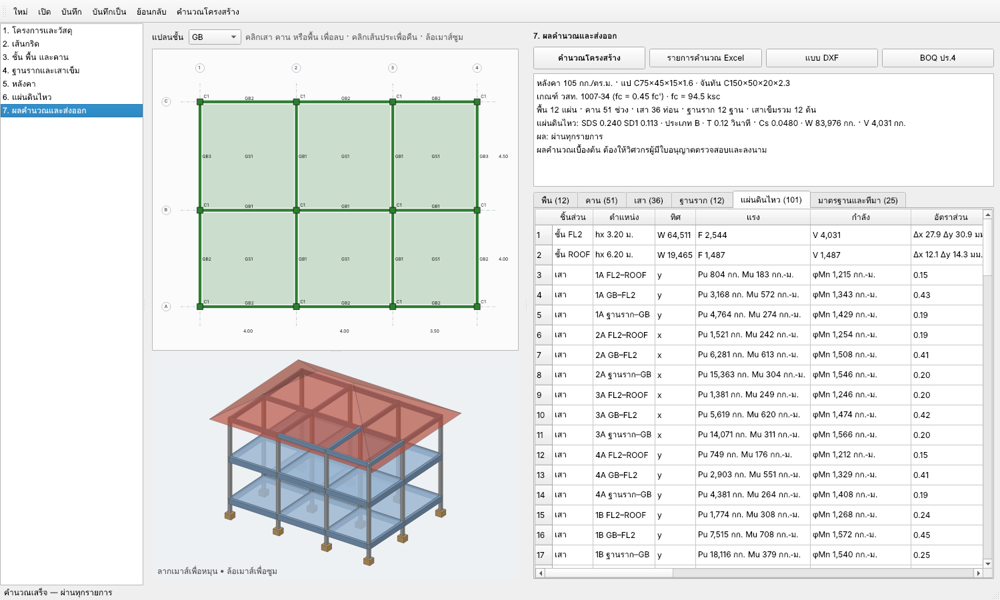):
  SDS/SD1 จาก Ss, S1 และชั้นดิน (หรือกรอกเองสำหรับแอ่งกรุงเทพฯ), ประเภทการออกแบบ A–D, T = 0.02H,
  Cs, V, Fx; วิเคราะห์โครงข้อแข็งระนาบทุกแนวกริดพร้อมแรงบิด 5%; ตรวจการเคลื่อนตัวระหว่างชั้นและ θ;
  ตรวจเสา (แผนภาพ P-M) คาน (โมเมนต์ปลายและแรงเฉือน 2E) เสาเข็ม/ดิน (รวมแรงถอน);
  เพิ่มเหล็ก ขยายเสา เพิ่มเข็มอัตโนมัติ และให้รายละเอียดเหล็กปลอกปลายคาน/เสา
  ([รายละเอียดสูตรและที่มา](STANDARDS.md#การออกแบบต้านทานแผ่นดินไหว-มยผ-13011302-61))

- **บันได** ช่วงเดียว / สองช่วงมีชานพักบนคานบันได BT (คลิกขวาที่ช่องพื้น → เพิ่มบันได):
  ตรวจลูกตั้ง ลูกนอน ความกว้าง ความสูงช่วง ตามกฎกระทรวง ฉบับที่ 55, น้ำหนักจรบันไดตามกฎกระทรวง ฉบับที่ 6,
  เพิ่มความหนาให้ถึงเกณฑ์, ส่งน้ำหนักลงคานชั้นล่าง/บน และคาน BT ลงเสา, เปิดช่องพื้นชั้นบน
  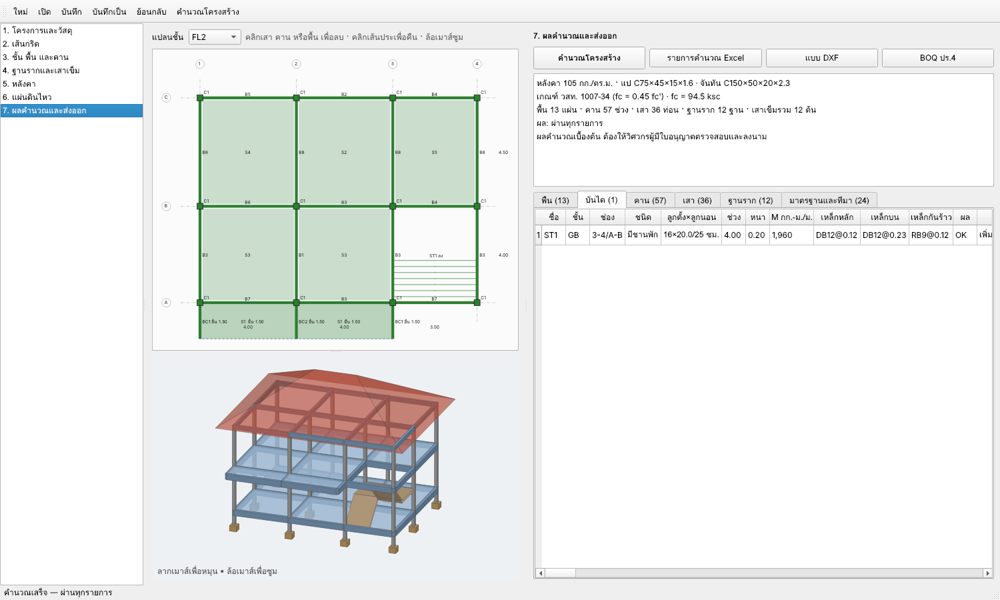
- **คานยื่น** (คลิกขวาที่เสาขอบ → เพิ่มคานยื่น) รับผนังและแรงจุดปลายได้ โมเมนต์ที่โคนส่งเข้าคานด้านใน
- **พื้นยื่นบนคานยื่น**: มีคานขอบที่ปลายอัตโนมัติ ออกแบบพื้นเป็นแผ่นวางบนคานสี่ด้าน

- **เสารับโมเมนต์**: วิเคราะห์โครงข้อแข็งทุกแนวกริดด้วยน้ำหนักแนวดิ่ง, ตรวจความชะลูดและตัวขยายโมเมนต์,
  ดัชนีเสถียรภาพ Q, กำลังเสาสองแกนด้วยแผนภาพ P-M, ปรับเหล็กบนปลายคานตามโมเมนต์จากโครง,
  ฐานรากรับโมเมนต์ที่โคนเสา 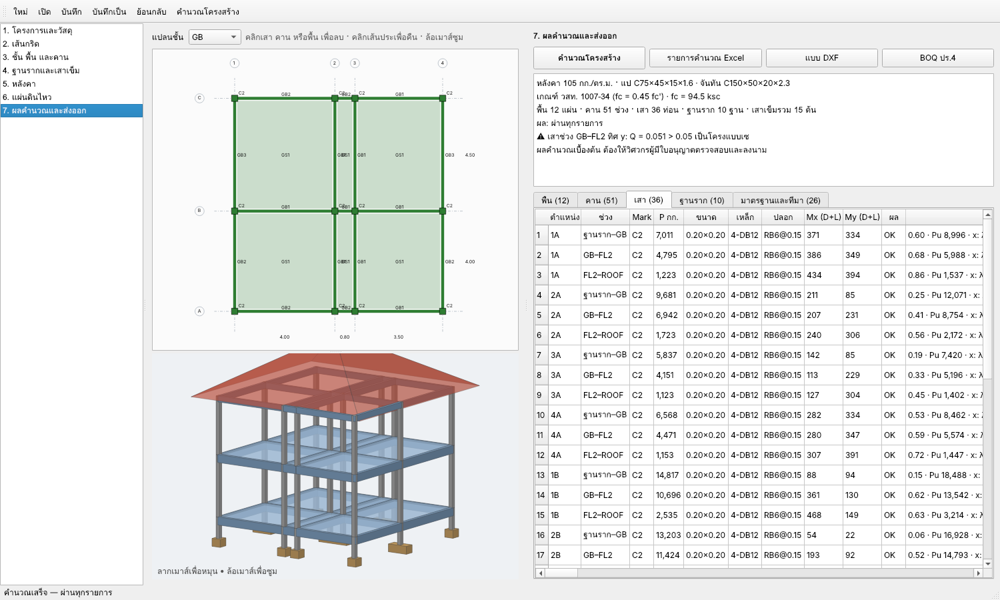
- **ฐานรากร่วม** สองเสา ทั้งฐานแผ่และฐานเข็ม เมื่อฐานเดี่ยวซ้อนกัน

- **กฎหมายฉบับปัจจุบัน** (เอกสารจากเจ้าของโครงการ): กฎกระทรวงออกแบบโครงสร้างอาคาร พ.ศ. 2566,
  ประกาศกระทรวงมหาดไทย 2567 และกฎกระทรวง ฉบับที่ 72 (2568) — น้ำหนักบรรทุก การรวมน้ำหนัก ตัวคูณลดกำลัง
  แรงลม ระยะแอ่นตัว ระยะหุ้ม รายละเอียดเหล็กเสริมขั้นต่ำ การทนไฟ ข้อมูลรายจังหวัด แผงโซลาร์เซลล์
  ([รายละเอียด](STANDARDS.md#กฎหมายและประกาศที่ใช้บังคับ-เอกสารที่เจ้าของโครงการส่งมา))

- **พื้นสำเร็จรูป** (ชนิดพื้น "พื้นสำเร็จรูป"): แผ่นวางทางเดียว ถ่ายน้ำหนักลงคานสองด้านที่รองรับ ตรวจกับค่ารับน้ำหนัก
  และช่วงสูงสุดจากตารางผู้ผลิตที่กรอก เหล็กเสริมผิวบนตามข้อ 29
- **โครงถักหลังคาเหล็ก** (ระบบโครงหลังคา "โครงถัก"): โครงถักจั่วแบบ Pratt ทุกแนวกริด วิเคราะห์แบบข้อหมุน
  ท่อเหล็กสี่เหลี่ยม มอก. 107 ออกแบบวิธีหน่วยแรงที่ยอมให้ตามประกาศ มท. 2567 ข้อ 27 และ AISC ASD
  (KL/r ≤ 200, L/r ≤ 300, แรงอัดร่วมแรงดัดที่จันทันบน) ระยะแอ่นตัวตามตาราง 1 แรงปฏิกิริยาลงเสา
  แรงยกจากลม 0.6D + W (ความเร็วลมรายจังหวัด ผนวก ก, มยผ. 1311), โครงถักขั้นบันไดของหลังคาปั้นหยา,
  หน้าตัดท่อรวมมุมโค้งตาม EN 10219 (ตรงกับแคตตาล็อก), รอยเชื่อมและสลักยึด/แผ่นรองฐาน (ส่วนปลอดภัย 2.00 ข้อ 27)
  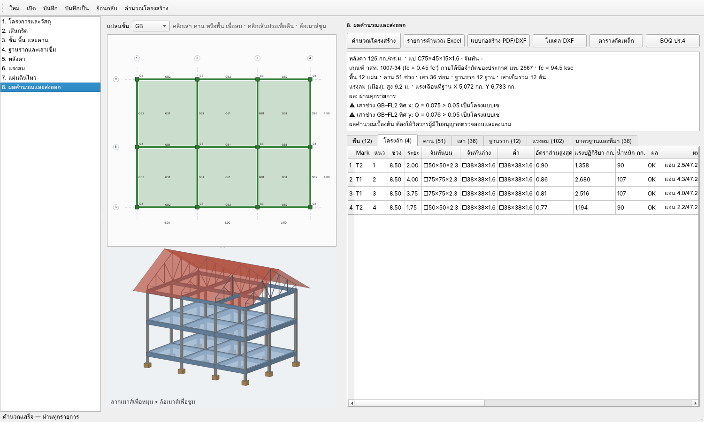 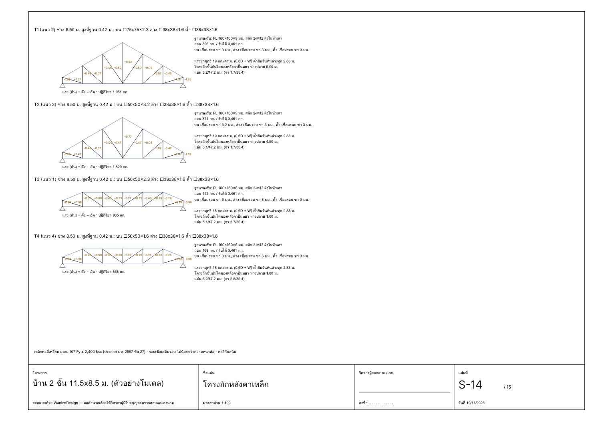
- **ทรงหลังคา 4 แบบ**: ปั้นหยา จั่ว เพิงหมาแหงน (โครงถักลาดเดียว) มนิลา (ปั้นหยาผสมจั่ว, โครงถักขั้นบันไดช่วงปั้นหยา),
  แบบที่นิยมของ 4 ภาค, เตือนความลาดต่ำกว่าคำแนะนำผู้ผลิตวัสดุมุง, ดาดฟ้าคอนกรีต (น้ำหนักจร 200),
  BOQ กระเบื้องลอนคู่และครอบปั้นลมตามรหัส ว480 ([รายละเอียด](STANDARDS.md#ทรงหลังคาและแบบที่นิยมตามภาค))
  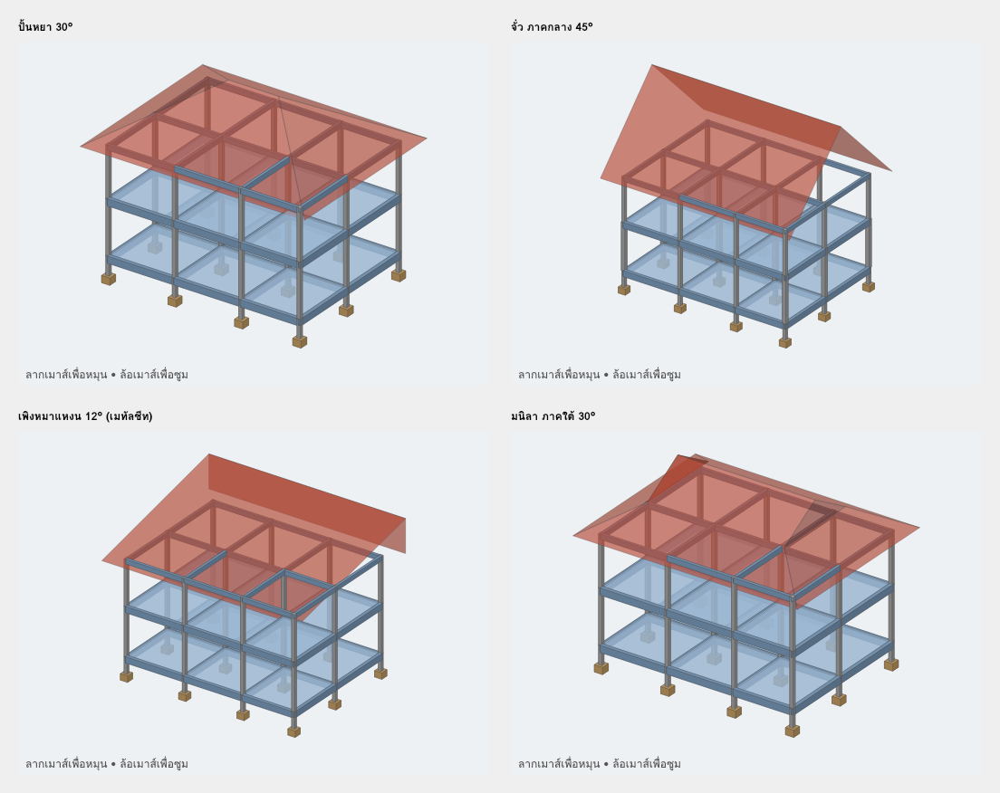

ยังเหลือ
- แผ่นดินไหว: โครงต้านแรงดัดแบบพิเศษ (ประเภท D), วิธีสเปกตรัมตอบสนอง, ความไม่สม่ำเสมอของอาคาร,
  ตาราง Ss/S1 รายอำเภอ (ต้องได้ตัวเล่มมาตรฐานก่อน)
- บันไดเฉียง/บันไดเหล็ก, Flat slab, แรงบิดในคานขอบพื้นยื่นอิสระ
- เสา: การจัดน้ำหนักจรแบบเว้นช่วง; ฐานรากร่วมเกินสองเสา และตรวจแผ่นดินไหวของฐานรากร่วม
- โครงถัก: ค่า Cp ละเอียดตาม มยผ. 1311 แยกตามความลาดและบริเวณ (ตอนนี้ใช้ค่าสุทธิ 1.6 ด้านปลอดภัย), แผ่นประกับรอยต่อ
- ทางเลือกออกแบบน้ำหนักบรรทุกแนวดิ่งด้วยวิธีกำลัง (USD) ทั้งระบบ
- ทุกข้อเพิ่มรหัสอ้างอิงใน `standards.py` และทดสอบเทียบตัวอย่างคำนวณมือ

## ช่วงที่ 5 — แบบก่อสร้าง (กำลังทำ)
เสร็จแล้ว: ชุดแบบ A3 พร้อมหัวแบบ (โครงการ ชื่อแผ่น มาตราส่วน ช่องลงนามวิศวกร เลขแผ่น) ส่งออก PDF และ DXF
(ปุ่ม "แบบก่อสร้าง PDF/DXF" และคำสั่ง `design`):
S-01 หมายเหตุทั่วไป (กฎหมาย วัสดุ หน่วยแรง ระยะหุ้มตาราง 13 ระยะฝัง/ทาบ/ของอตาม ACI 318 12.2 น้ำหนัก ฐานราก การทนไฟ),
แปลนโครงสร้างทุกชั้น, แปลนฐานราก, ตารางฐานราก (แปลนและรูปตัด) ตารางเสา (รูปตัด) ตารางคาน (รูปตัด 1:10)
ตารางพื้น รายละเอียดพื้นทั่วไป ตารางและรูปตัดบันได, รูปด้านคานทุกแนว (เหล็กบน/ล่าง ขอ ทาบ เหล็กปลอก),
รูปด้านเสา (ทาบเหนือพื้นทุกชั้น ปลอกเสา), สรุปตารางตัดเหล็ก
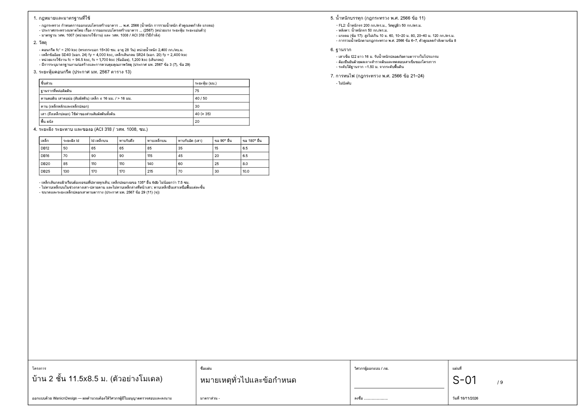 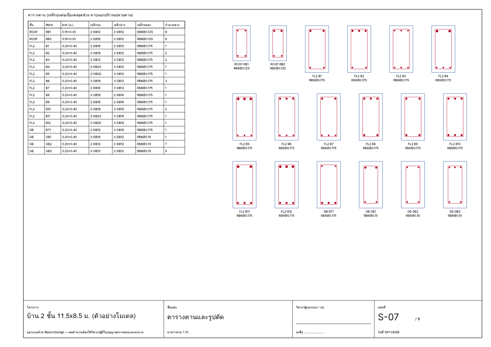 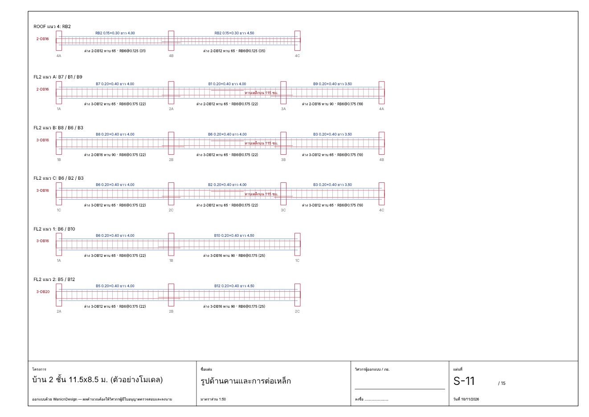

ยังเหลือ
- สารบัญแบบ, หัวแบบแนวตั้ง, เหล็กเสริมพิเศษที่หัวเสา (ลดเหล็กบนต่อเนื่อง)
- ส่งออก DWG, วาดลง AutoCAD ผ่าน COM, แบบสถาปัตย์

## ช่วงที่ 6 — ตารางตัดเหล็ก (Bar Cutting List) — ส่วนแรกเสร็จแล้ว
เสร็จแล้ว: ทุกท่อนของคาน (เหล็กบนต่อเนื่องทาบกลางช่วง เหล็กล่างทาบเหนือหัวเสา ขอ 90° ที่เสาริม เหล็กปลอก
รวมช่วงปลายตามแผ่นดินไหว) เสา (ขางอที่ฐานราก ทาบ class B เหนือพื้น ขอเข้าคานบนสุด ปลอก) ฐานราก พื้น บันได;
ความยาวตามแนวศูนย์กลางรวมส่วนโค้งและขอตาม ACI 318 ข้อ 7.1–7.2; ตัดจากเหล็ก 10 ม. แบบ first-fit decreasing
พร้อมเศษและน้ำหนักซื้อ (ไฟล์ ตารางตัดเหล็ก.xlsx และแผ่นแบบสรุป)
ยังเหลือ:
- ระยะหุ้มแยกตามชิ้นส่วน, ทาบ 40d, ของอ 12d, เหล็กเสริมพิเศษที่หัวเสาและกลางช่วง
- ตารางตัดเหล็กต่อชิ้นและรวมทั้งโครงการ, การตัดเหล็กเส้น 10 ม. ให้เศษน้อยที่สุด

## ช่วงที่ 7 — BOQ ครบทุกหมวด และราคากลาง (กำลังทำ)
เสร็จแล้ว: ขั้นตอน "งานสถาปัตย์" — ชนิดประตูหน้าต่าง, วัสดุพื้นและฝ้าแต่ละชั้น; คลิกขวาที่แปลนเพื่อวางประตู/หน้าต่าง
เพิ่มผนังกั้นห้อง (คิดน้ำหนักลงคานด้วย) และกำหนดห้องน้ำ (ผนังรอบห้อง กระเบื้องพื้น บุผนังสูง 2.00 ม. สุขภัณฑ์ 9 รายการ);
BOQ ออกรายการปูพื้น ฝ้า บุผนัง สุขภัณฑ์ กระจก วงกบ บาน อุปกรณ์ประตู พร้อมรหัสค่าแรง ว480 หักช่องเปิดจากผนัง
และไม่ทาสีบนกระเบื้อง; แบบก่อสร้างแสดงตำแหน่งประตูหน้าต่าง ห้องน้ำ และตารางประตูหน้าต่าง
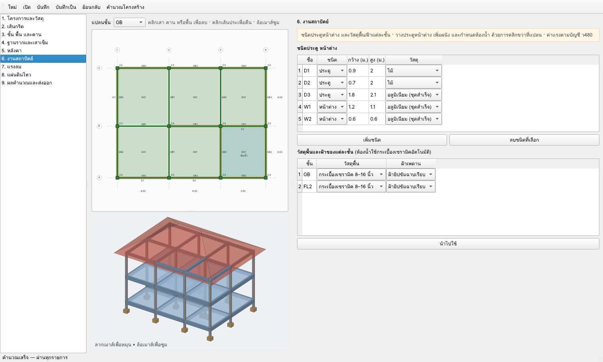

เสร็จแล้ว: **ราคากลาง** (ขั้นตอน "9. ราคากลาง") — ค่าวัสดุต่อหน่วยจากสูตรวัสดุมวลรวม กรมบัญชีกลาง 2569
(261 สูตร ถอดจาก 3D core) × สมุดราคารายจังหวัด (อ่านตารางพาณิชย์จังหวัด .xlsx/.csv จับคู่ชื่อและแปลงหน่วย
ตัน→กก. ถุง→กก. ใช้โฟลเดอร์เดียวกับ WANICNSURVEY 3D), ค่าแรง ว480, Factor F (ค่าเดียวหรือตารางเทียบอัตราส่วน),
แบบ ปร.4 / ปร.1 (ก) / ปร.1 ตามหลักเกณฑ์ 2569 พร้อมราคาตัวอักษร ช่องลงนามคณะกรรมการ
แผ่นราคาวัสดุและวิเคราะห์ค่าวัสดุทุกบรรทัด (ระบุสูตรและหน้า) 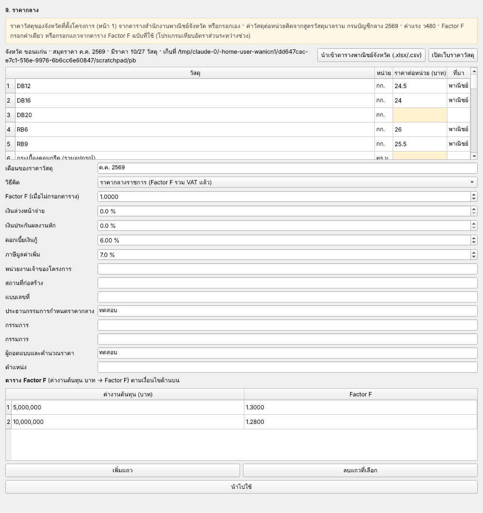
ยังเหลือ:
- ✅ งานระบบไฟฟ้า ประปา จากโมเดล (ค่าแรง ว480 หมวด 3–4) 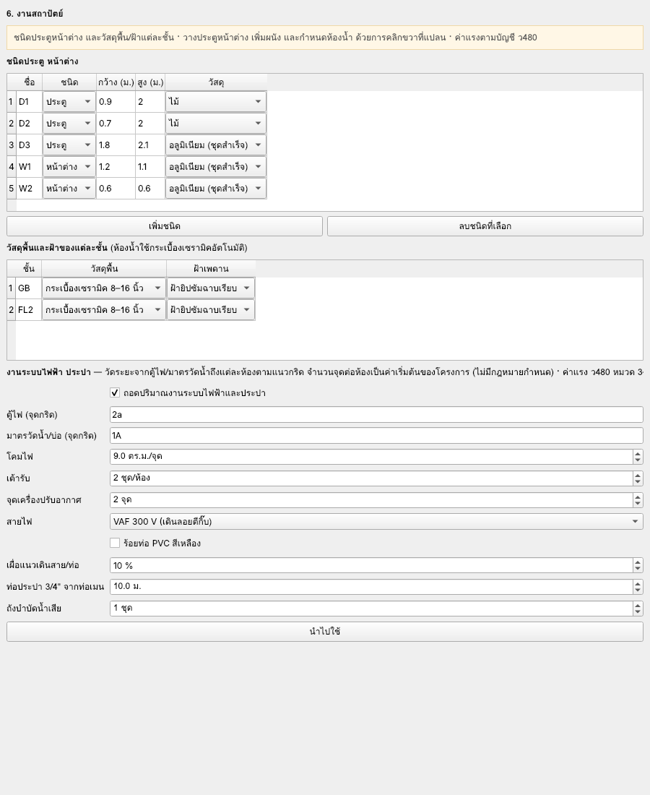 และแบบ ปร.2 ปร.2 (ก) ปร.3
- ✅ ราคากลางหลายอาคารในสัญญาเดียว (ข้อ 9.3 ข้อ 3): ปุ่ม "ราคากลางหลายอาคาร" หรือคำสั่ง `contract` —
  ปร.1 แยกชุดต่ออาคาร (งานหรือกลุ่มงาน) Factor F จากค่างานต้นทุนรวม ปร.1 (ก) ปร.2 ปร.3 ปร.4 ชุดเดียว
- วางจุดไฟฟ้า/สุขภัณฑ์บนแปลนทีละจุด, ระบบปรับอากาศ
- ✅ ตาราง Factor F งานอาคาร ว 481 (26 มิ.ย. 2569) 12 ตาราง บรรจุแล้ว เลือกตามเงินล่วงหน้า/ประกันผลงาน
  พร้อมกรณีเงินกู้ไม่เสียภาษี (ข้อ 9.3) — เมื่อกรมบัญชีกลางประกาศดอกเบี้ยใหม่ ให้กรอกตารางใหม่ในหน้า 9 หรือปรับไฟล์ข้อมูล
- เลือกสูตรวัสดุอื่นได้ต่อรายการ (ตอนนี้: อิฐมอญ 6.1, มวลเบา 6.10, ฉาบ 7.2, ทับหลัง 4.1, พื้นกระเบื้อง 9.30/9.36/9.38/9.40,
  ขัดมัน 9.3, บุผนัง 7.33+7.1); ฝ้ายิปซัมฉาบเรียบไม่มีสูตรในเอกสาร ให้กรอกราคาวัสดุเอง
- รายงาน BOQ ที่คลิกรายการแล้วเห็นชิ้นส่วนในโมเดล

## ช่วงที่ 8 — แผนงานก่อสร้างและการส่งต่อข้อมูล (กำลังทำ)
เสร็จแล้ว: แผนงานก่อสร้างแบบ CPM ในไฟล์ราคากลาง (แผ่น "แผนงานก่อสร้าง") — ระยะเวลาแต่ละงาน = ค่าแรง ว480 ในใบประมาณราคา
÷ (คนงาน × ค่าแรงต่อวัน), ลำดับงานตามปกติของอาคาร ค.ส.ล. (ฐานราก → โครงสร้าง → หลังคา/ก่อฉาบ → งานระบบ (เริ่มกลางงานก่อ)
→ พื้นผนังฝ้า → สุขภัณฑ์ ทาสี), หางานวิกฤต (สีแดง) เวลาเผื่อ และ S-Curve ผลงานสะสมจากค่าก่อสร้าง × Factor F;
ค่าแรงต่อวัน วันทำงาน และจำนวนคนงานเป็นค่าของโครงการ (หลักเกณฑ์ไม่ได้กำหนด — ระบุแผน CPM เป็นค่าใช้จ่ายพิเศษ ส่วนที่ 3 ข้อ 6)
- ✅ งานโครงสร้างแยกรายชั้น (แบ่งค่าแรงตามสัดส่วนปริมาตรคอนกรีต: ฐานราก+เสาตอม่อ+คานคอดิน แล้วชั้นถัดไปพร้อมเสาชั้นล่าง)
  งานก่อเริ่มเมื่อหล่อชั้นใต้หลังคาเสร็จ หลังคาตามชั้นบนสุด
- ✅ งวดงานรายเดือนจาก S-Curve (ช่วงเวลารับเงิน D ในสูตรดอกเบี้ย Factor F ข้อ 9.2) หักคืนเงินล่วงหน้าและเงินประกันผลงาน
  ตามอัตราในหน้า 9
ยังเหลือ:
- ส่งออก MS Project / XML, ปรับงวดงานตามสัญญาจริง (งวดตามผลงานที่กำหนดเอง)
- ส่งออก IFC และ SketchUp

## ช่วงที่ 9 — ตัวติดตั้งบน Windows (เสร็จแล้ว)
- WanicnDesign อยู่ในตัวติดตั้งชุดเดียวกับ WANICNSURVEY (`installer/wanicnsurvey.iss`): ติดตั้งที่ `{app}\design`,
  การ์ด «ออกแบบอาคาร» ในหน้าเริ่มต้น, เมนู Start, ไอคอน `branding/wanicnsurvey-design.*`
- `design/WanicnDesign/wanicndesign.spec` (PyInstaller) รวมตารางข้อมูลทั้งหมด; `wanicndesign.exe --check` ทดสอบชุดติดตั้ง
  (ตาราง ว480 สูตรวัสดุ Factor F จังหวัด → ออกแบบ → ราคากลาง → แผนงาน); ไฟล์ของผู้ใช้เก็บใน `%APPDATA%\WANICNSURVEY`
- สร้างบนเครื่อง: `build-windows.bat`; บน GitHub: Actions ▸ build-windows ▸ Run workflow (ทดสอบ 121 รายการก่อนสร้าง)

---

## ข้อจำกัดของรุ่นปัจจุบันที่ต้องรู้
- คานซอยแบ่งได้ 1 เส้นต่อแผ่นพื้น, บันไดวางได้เฉพาะในช่องกริด, คานขอบพื้นยื่นอิสระยังไม่ตรวจแรงบิด,
  ไม่จัดน้ำหนักจรแบบเว้นช่วง
- ค่าสัมประสิทธิ์พื้นกรณี 1–4 และเกณฑ์ที่สถานะ recall ต้องตรวจกับมาตรฐานฉบับจริง
- คานคิดจุดรองรับเป็นหมุด ไม่รวมความแข็งของเสา, ตรวจการแอ่นตัวด้วยความลึกน้อยที่สุดเท่านั้น
- เสาคิดแรงอัดตามแนวแกนอย่างเดียว ไม่รวมโมเมนต์และความชะลูด
- ฐานรากไม่รวมน้ำหนักดินถมเหนือฐาน
- ค่ากำลังรับของเสาเข็มมาจากตารางในคู่มือเดิม ต้องปรับตามผลเจาะสำรวจดินจริง
- ตารางเหล็กตัวซีบางขนาดเป็นค่าประมาณ (ระบุในไฟล์ `data/steel_sections.json`)
