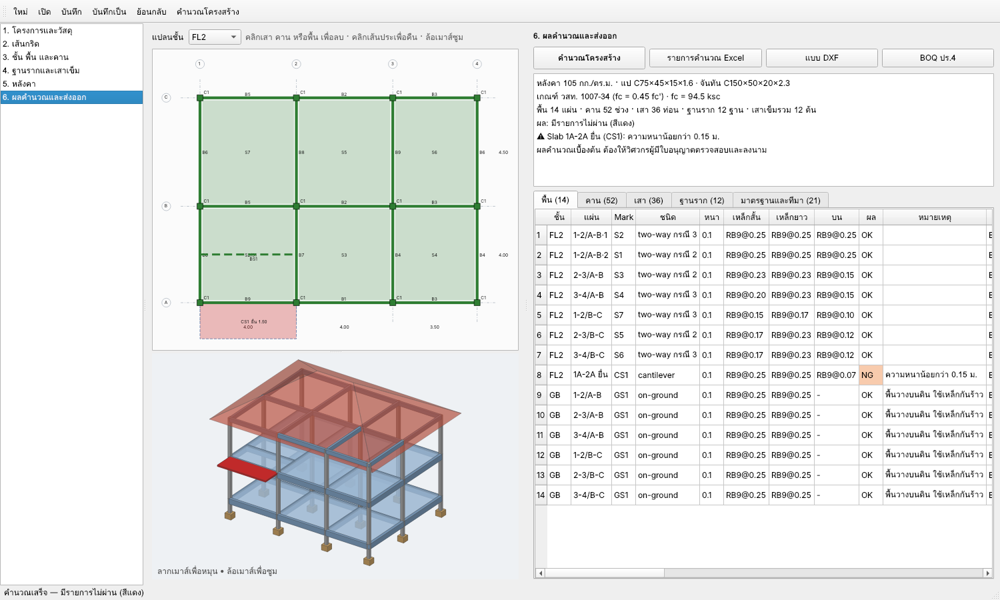
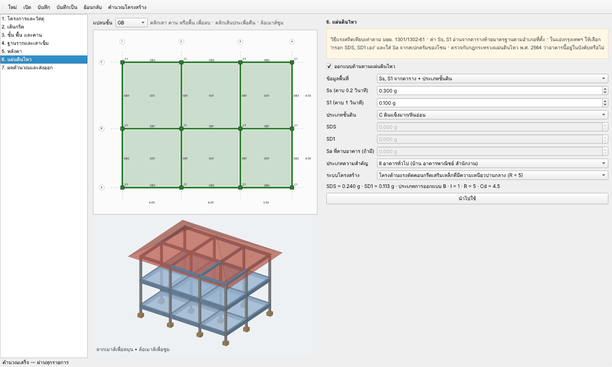

# แผนการพัฒนา WanicnDesign

แนวทาง: **สร้างโมเดลอาคารก่อน แล้วจึงคำนวณโครงสร้าง ตั้งแต่หลังคาลงถึงเสาเข็ม**
จากนั้นนำขนาดและเหล็กที่ออกแบบได้ไปทำแบบก่อสร้าง ตารางตัดเหล็ก และ BOQ โดยอัตโนมัติ

แหล่งอ้างอิงลำดับการทำงาน
- คู่มือและวิดีโอโปรแกรม QuickDesign (สรุปใน `docs/workflow.md`)
- คลิปโปรแกรม SM-3D-STRUCTURE จากเพจ Facebook ที่ผู้ใช้ส่งมา (โมเดลบนกริด ชนิดชิ้นส่วน
  F/C/GB/B/RB, โมเดล 3 มิติ, Bar Cutting List, รายงาน BOQ ที่เชื่อมกับโมเดล)

โค้ดและสูตรคำนวณเขียนขึ้นใหม่ทั้งหมด ผลคำนวณต้องให้วิศวกรผู้มีใบอนุญาตตรวจและลงนาม

---

## ✅ ช่วงที่ 1 — ปริมาณงานและค่าแรง (เสร็จแล้ว)
- ถอดปริมาณงานดิน คอนกรีต ไม้แบบ เหล็กเสริม ก่อ ฉาบ ทาสี ประตูหน้าต่าง หลังคา
- การเผื่อตามเกณฑ์กรมบัญชีกลาง 2569, ค่าแรง ว480 (26 มิ.ย. 2569) 78 รายการ แก้ไขได้
- ใบ ปร.4 ส่งออก Excel พร้อมสูตร, วาดกริดเป็น DXF หรือใน AutoCAD

## ✅ ช่วงที่ 2 — โมเดลอาคารและการคำนวณโครงสร้าง (เสร็จแล้ว รุ่นแรก)
- โมเดลบนกริด: ระดับชั้น, สร้างเสา คาน แผ่นพื้น ฐานรากอัตโนมัติ, ตัดเสาบางตำแหน่งได้
- ลำดับคำนวณ: หลังคา (แป จันทัน) → พื้น (ทางเดียว / สองทาง กรณี 5) → คาน (คานต่อเนื่อง
  วิธีสติฟเนส ขยายความลึกอัตโนมัติ) → เสา (สะสมน้ำหนักทุกชั้น ขยายหน้าตัดอัตโนมัติ)
  → ฐานราก → จำนวนเสาเข็ม (เปลี่ยนขนาดเข็มอัตโนมัติเมื่อเกิน 5 ต้น)
- จัดกลุ่มชิ้นส่วนเป็น Mark (S1, GB1, B1, RB1, C1, F1), รายการคำนวณ Excel
- แบบแปลนโครงสร้างทุกชั้นและโมเดล 3 มิติเป็น DXF, ส่งผลออกแบบไปทำ BOQ อัตโนมัติ
- ทดสอบ 22 รายการ รวมการเทียบกับตัวอย่างคำนวณแปในคู่มือเดิม

---

## ✅ ช่วงที่ 3 — หน้าจอแก้ไขโมเดล (เสร็จส่วนแรก)
ทำแล้ว
- หน้าจอ PySide6: ขั้นตอน 1–6 ด้านซ้าย, แปลนและ 3 มิติตรงกลาง, ฟอร์มแต่ละขั้นด้านขวา
- กริดแบบระยะ (4, 4, 3.5 หรือ 3*4) สร้างเสา คาน พื้น ฐานรากอัตโนมัติ
- แปลนแบบคลิก: ลบ/คืน เสา คาน แผ่นพื้นรายชั้น, ระบายสีผลคำนวณพร้อม Mark
- ตารางชั้น (ระดับ ชนิดพื้น ความหนา น้ำหนักจร ขนาดคาน ผนัง), ฐานราก/เสาเข็ม, หลังคา
- มุมมอง 3 มิติ หมุนและซูมได้ (วาดด้วย QPainter ไม่ต้องใช้การ์ดจอ)
- คำนวณ (F5), ตารางผล, ส่งออก Excel/DXF/BOQ, บันทึก/เปิดโมเดล, ย้อนกลับ (Ctrl+Z)
- ทดสอบหน้าจอ 7 รายการ (รันแบบไม่มีจอได้)

ยังไม่ได้ทำ (ย้ายไปทำพร้อมช่วงที่ 4 เพราะต้องคำนวณได้ก่อน)
- วางชิ้นส่วนใหม่นอกกริด: คานซอย คานยื่น พื้นยื่น บันได
- กำหนดขนาด/เหล็กเฉพาะชิ้น (ตอนนี้ขนาดกำหนดรายชั้น และโปรแกรมขยายเองเมื่อไม่พอ)
- คัดลอกชั้น, ลากเส้นกริดด้วยเมาส์, ใช้ viewport OpenGL ของโปรแกรม 3D ใน repo

## ✅ ช่วงที่ 4ก — มาตรฐานและที่มาทุกขั้นตอน (เสร็จแล้ว)
- ทุกค่าและสูตรอ้างรหัสมาตรฐาน (`wanicndesign/standards.py`, `docs/STANDARDS.md`)
  พร้อมสถานะ: จากเอกสารที่ได้รับ / จากมาตรฐานทั่วไป (ต้องตรวจกับฉบับจริง) / ข้อมูลโครงการ
- รายงานคำนวณ BOQ และหน้าจอ มีแผ่น "มาตรฐานและที่มา" และคอลัมน์อ้างอิงทุกแถว
- เลือกเกณฑ์หน่วยแรงได้: วสท. 1007-34 หรือ กฎกระทรวง ฉบับที่ 6
- น้ำหนักบรรทุกจรตามประเภทการใช้อาคาร (กฎกระทรวง ฉบับที่ 6 ข้อ 15)
- ลดน้ำหนักบรรทุกจรสำหรับเสาและฐานราก (ข้อ 16) ยกเว้นอาคารประเภทที่ไม่อนุญาต
- พื้นสองทางครบกรณี 1–5 ตามจำนวนขอบที่ไม่ต่อเนื่องจริง
- ตรวจความลึกคานตามเกณฑ์การแอ่นตัว, ตรวจการแอ่นตัวแปและจันทัน L/240
- ฐานรากตรวจแรงเฉือนทางเดียวเพิ่มจากแรงเฉือนทะลุ

## ช่วงที่ 4ข — ชิ้นส่วนที่ยังขาด (กำลังทำ)
เสร็จแล้ว ()
- คานซอยแบ่งแผ่นพื้น (คลิกขวาที่พื้น → เพิ่มคานซอย X/Y) ออกแบบเป็นคานช่วงเดียวรับน้ำหนักพื้นแบบ 45°
  และส่งแรงปฏิกิริยาเป็นแรงจุดเข้าคานหลัก (คานรับคาน) [STATICS, EIT1007-SLAB]
- พื้นยื่น (คลิกขวาที่คานขอบ → เพิ่มพื้นยื่น) M = wL²/2, ตรวจความหนา ≥ L/10 [EIT1007-SLABMIN]
  น้ำหนักลงคานขอบ (ยังไม่รวมแรงบิดในคานขอบ)
- คานต่อเนื่องรับแรงจุดและน้ำหนักแผ่บางช่วงได้ (วิธีสติฟเนส)
- **แก้ไขสำคัญ:** น้ำหนักพื้นลงคานใช้พื้นที่รับน้ำหนักแบบ 45° (สามเหลี่ยม/คางหมู) ตรงตามจริง
  รุ่นก่อนใช้ค่า wS/3 ซึ่งเป็นค่าเทียบเท่าสำหรับโมเมนต์เท่านั้น ทำให้แรงที่ส่งลงเสาและฐานรากสูงเกิน
  (สูงสุดราว 33%, ด้านปลอดภัย) ตอนนี้มีทดสอบสมดุลว่าน้ำหนักทั้งชั้นเท่ากับแรงปฏิกิริยารวม

- **แผ่นดินไหว** ตาม มยผ. 1301/1302-61 วิธีแรงสถิตเทียบเท่า (ขั้นที่ 6 ในโปรแกรม,
   ):
  SDS/SD1 จาก Ss, S1 และชั้นดิน (หรือกรอกเองสำหรับแอ่งกรุงเทพฯ), ประเภทการออกแบบ A–D, T = 0.02H,
  Cs, V, Fx; วิเคราะห์โครงข้อแข็งระนาบทุกแนวกริดพร้อมแรงบิด 5%; ตรวจการเคลื่อนตัวระหว่างชั้นและ θ;
  ตรวจเสา (แผนภาพ P-M) คาน (โมเมนต์ปลายและแรงเฉือน 2E) เสาเข็ม/ดิน (รวมแรงถอน);
  เพิ่มเหล็ก ขยายเสา เพิ่มเข็มอัตโนมัติ และให้รายละเอียดเหล็กปลอกปลายคาน/เสา
  ([รายละเอียดสูตรและที่มา](STANDARDS.md#การออกแบบต้านทานแผ่นดินไหว-มยผ-13011302-61))

ยังเหลือ
- แผ่นดินไหว: โครงต้านแรงดัดแบบพิเศษ (ประเภท D), วิธีสเปกตรัมตอบสนอง, ความไม่สม่ำเสมอของอาคาร,
  ตาราง Ss/S1 รายอำเภอ (ต้องได้ตัวเล่มมาตรฐานก่อน)
- คานยื่น, บันได (คานบันได BT), พื้นสำเร็จรูป, Flat slab, แรงบิดในคานขอบพื้นยื่น
- เสา: โมเมนต์จากคาน และความชะลูด; ฐานรากร่วม
- โครงหลังคาเหล็ก: โครงถัก (Finite element), เหล็กกล่อง; แรงลมสำหรับโรงงาน
- ทางเลือกออกแบบน้ำหนักบรรทุกแนวดิ่งด้วยวิธีกำลัง (USD) ทั้งระบบ
- ทุกข้อเพิ่มรหัสอ้างอิงใน `standards.py` และทดสอบเทียบตัวอย่างคำนวณมือ

## ช่วงที่ 5 — แบบก่อสร้าง
- แผ่นแบบพร้อมกรอบชื่อ (หัวแบบ) แนวตั้งและแนวนอน, สารบัญแบบ, เปลี่ยนเลขแบบ
- รูปตัดคาน เสา ฐานราก พื้น พร้อมเหล็กเสริม และตารางรายละเอียดชิ้นส่วน
- ส่งออก DWG/DXF/PDF, วาดลง AutoCAD ผ่าน COM

## ช่วงที่ 6 — ตารางตัดเหล็ก (Bar Cutting List)
- ระยะหุ้มแยกตามชิ้นส่วน, ทาบ 40d, ของอ 12d, เหล็กเสริมพิเศษที่หัวเสาและกลางช่วง
- ตารางตัดเหล็กต่อชิ้นและรวมทั้งโครงการ, การตัดเหล็กเส้น 10 ม. ให้เศษน้อยที่สุด

## ช่วงที่ 7 — BOQ ครบทุกหมวด
- งานสถาปัตย์ ประตูหน้าต่าง ฝ้า พื้นผิว สุขภัณฑ์ ไฟฟ้า ประปา จากโมเดล
- ราคาวัสดุจากสำนักงานพาณิชย์จังหวัด (ใช้ระบบราคาจังหวัดที่มีใน repo), ปร.4 ปร.5 ปร.6, Factor F
- รายงาน BOQ ที่คลิกรายการแล้วเห็นชิ้นส่วนในโมเดล

## ช่วงที่ 8 — แผนงานก่อสร้างและการส่งต่อข้อมูล
- แผนงานก่อสร้าง (Gantt) จากปริมาณงานและอัตราการทำงาน, ส่งออก Excel/MS Project
- ส่งออก IFC และ SketchUp

## ช่วงที่ 9 — ตัวติดตั้งบน Windows
- ใช้ระบบสร้างตัวติดตั้งที่มีใน repo (`installer/`, `build-windows.ps1`)

---

## ข้อจำกัดของรุ่นปัจจุบันที่ต้องรู้
- คานซอยแบ่งได้ 1 เส้นต่อแผ่นพื้น, ยังไม่มีคานยื่นและบันได, คานขอบพื้นยื่นยังไม่ตรวจแรงบิด
- ค่าสัมประสิทธิ์พื้นกรณี 1–4 และเกณฑ์ที่สถานะ recall ต้องตรวจกับมาตรฐานฉบับจริง
- คานคิดจุดรองรับเป็นหมุด ไม่รวมความแข็งของเสา, ตรวจการแอ่นตัวด้วยความลึกน้อยที่สุดเท่านั้น
- เสาคิดแรงอัดตามแนวแกนอย่างเดียว ไม่รวมโมเมนต์และความชะลูด
- ฐานรากไม่รวมน้ำหนักดินถมเหนือฐาน
- ค่ากำลังรับของเสาเข็มมาจากตารางในคู่มือเดิม ต้องปรับตามผลเจาะสำรวจดินจริง
- ตารางเหล็กตัวซีบางขนาดเป็นค่าประมาณ (ระบุในไฟล์ `data/steel_sections.json`)
