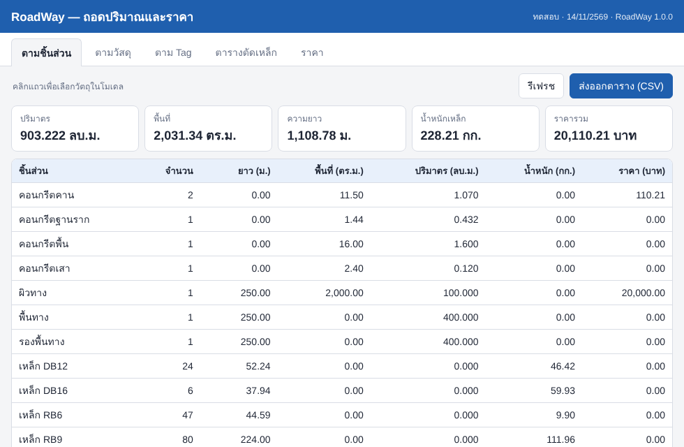
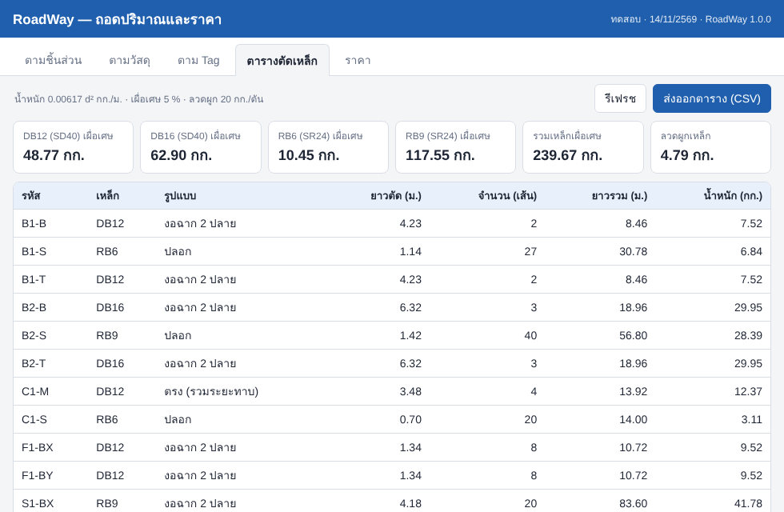
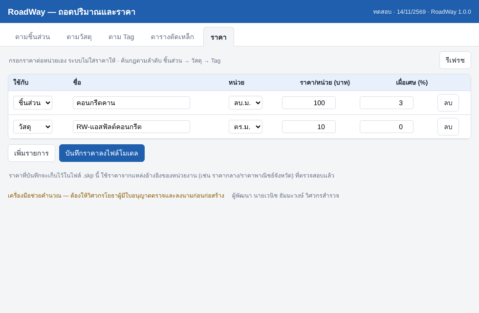

# RoadWay 1.0.0 — ส่วนขยาย SketchUp ภาษาไทย (WANICNSURVEY)

รวม 3 ชุดเครื่องมือไว้ในส่วนขยายเดียว แถบเครื่องมือเดียว และเมนูเดียว (**Extensions ▸ RoadWay**)

| ชุด | ทำงานแบบเดียวกับ | เครื่องมือ |
|---|---|---|
| 1. โปรไฟล์ | Profile Builder | โปรไฟล์ตามแนว (10 หน้าตัด) · โปรไฟล์จากหน้าที่เลือก · ชิ้นส่วนเรียงตามแนว · **ถนนตามแนว** |
| 2. ถอดปริมาณและราคา | Quantifier Pro | รายงานตามชิ้นส่วน/วัสดุ/Tag · ราคาต่อหน่วยเก็บในไฟล์ .skp · ส่งออก CSV |
| 3. เหล็กเสริม | Toh Rebar | คาน · เสา · พื้น/ฐานราก · เหล็กตามแนว · **ตารางตัดเหล็ก** |


> เขียนขึ้นใหม่ทั้งหมด ไม่ได้ใช้โค้ด ไฟล์ หรือหน้าจอของโปรแกรมเชิงพาณิชย์ข้างต้น
> **เครื่องมือช่วยคำนวณ — ต้องให้วิศวกรโยธาผู้มีใบอนุญาตตรวจและลงนามก่อนก่อสร้าง**

## ติดตั้ง
1. ดาวน์โหลด `dist/RoadWay-1.0.0.rbz` (บน GitHub กดที่ไฟล์ ▸ ปุ่ม Download raw file)
2. SketchUp ▸ **Extensions ▸ Extension Manager ▸ Install Extension** ▸ เลือกไฟล์ `.rbz` ▸ Yes
3. ถ้าไม่เห็นแถบเครื่องมือ: **View ▸ Toolbars ▸ RoadWay**

รองรับ SketchUp 2017 ขึ้นไป บน Windows และ macOS

## วิธีใช้สั้นๆ
| เครื่องมือ | ขั้นตอน |
|---|---|
| โปรไฟล์ตามแนว | วาดแนวด้วย Line/Arc ▸ เลือกเส้นทั้งหมด ▸ กดปุ่ม ▸ เลือกหน้าตัด จุดยึด วัสดุ ▸ กรอกขนาด (ม.) |
| โปรไฟล์จากหน้าที่เลือก | วาดหน้าตัดเองให้ตั้งฉากกับแนวที่ปลายเส้น ▸ เลือกหน้าตัดและเส้นแนว ▸ กดปุ่ม |
| ชิ้นส่วนเรียงตามแนว | ทำชิ้นส่วนเป็น Component ▸ เลือก Component และเส้นแนว ▸ ใส่ระยะห่าง |
| ถนนตามแนว | เลือกแนวศูนย์กลาง (ระดับหลังถนน) ▸ กรอกช่องจราจร ไหล่ทาง ความลาด ความหนาแต่ละชั้นตามแบบมาตรฐานที่ใช้ |
| เหล็กเสริมคาน | (เลือกเส้น 1 เส้นเป็นแนวหลังคานได้) ▸ กรอกขนาดและเหล็ก เช่น `2-DB12` `RB6@0.15` ▸ คลิกจุดวาง |
| เหล็กเสริมเสา / พื้น / ฐานราก | กรอกขนาดและเหล็ก ▸ คลิกจุดวางในโมเดล |
| เหล็กตามแนว | วาดรูปเหล็กดัดด้วยเส้น ▸ เลือก ▸ ใส่ขนาด เช่น `DB16` |
| ถอดปริมาณและราคา | เปิดหน้าต่าง ▸ แท็บ ตามชิ้นส่วน / วัสดุ / Tag / ตารางตัดเหล็ก / ราคา ▸ ส่งออก CSV |

**หลักคำนวณเหล็ก:** ใช้หลักเดียวกับ WANICNSURVEY 3D
- น้ำหนัก 0.00617 d² กก./ม. · SD40 (DB), SR24 (RB)
- ระยะหุ้ม: ฐานราก 7.5 ซม. · ตอม่อ 4 ซม. · เสา 3.5 ซม. · คาน 3 ซม. · พื้น 2 ซม.
- ทาบ 40d (DB) หรือ 48d (RB) ไม่น้อยกว่า 0.30 ม. · ขอ 12d · ขอเหล็กปลอก 135° คิดเพิ่ม 0.10 ม. x 2
- เผื่อเศษ 5 % · ลวดผูกเหล็ก 20 กก./ตัน

**ราคา:** ระบบไม่ใส่ราคาให้ ผู้ใช้กรอกราคาต่อหน่วยจากแหล่งอ้างอิงที่ตรวจสอบแล้วในแท็บ «ราคา»

## ภาพหน้าจอ
| ตามชิ้นส่วน | ตารางตัดเหล็ก | ราคา |
|---|---|---|
|  |  |  |

## สำหรับผู้พัฒนา
```bash
cd sketchup/roadway
ruby test/test_pure.rb     # ส่วนคำนวณ (หน้าตัด เหล็ก รายงาน)
ruby test/test_smoke.rb    # ทุกคำสั่งกับ SketchUp API จำลอง
./build_rbz.sh             # ทดสอบ + สร้าง dist/RoadWay-<รุ่น>.rbz
```
| ไฟล์ | หน้าที่ |
|---|---|
| `src/roadway.rb` | ตัวลงทะเบียนส่วนขยาย |
| `src/roadway/core.rb` | เมนู แถบเครื่องมือ ฟังก์ชันใช้ร่วม |
| `geo.rb` `profiles.rb` `rebar_calc.rb` `report.rb` | คำนวณแบบ Ruby ล้วน (ทดสอบนอก SketchUp ได้) |
| `sweep.rb` | กวาดหน้าตัดตามแนว (Follow Me) |
| `profile_builder.rb` `road_builder.rb` `rebar.rb` `quantifier.rb` + `quantifier.html` | เครื่องมือแต่ละชุด |

ผู้พัฒนา **นายเวนิช ธัมมะวงษ์ วิศวกรสำรวจ** — WANICNSURVEY 2026
